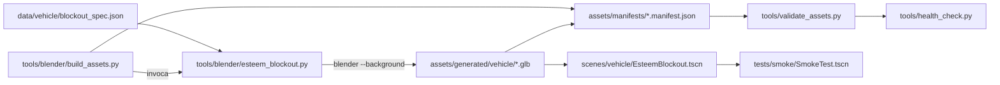

# Fábrica de assets 3D (Blender headless)

**Estado:** implementada en Fase 1.3. Primer asset: bloqueo del Esteem con
LOD0/LOD1/LOD2 y ancla de rig. Sin mecánicas de conducción.  
**Regla maestra:** todo modelo procede de un script `bpy` reproducible y todo
asset generado tiene manifiesto con comando, hash, autor, licencia y fecha
(`AGENTS.md`, sección 11).

## 1. Principio

Ningún `.blend` se edita a mano. La fábrica construye geometría paramétrica a
partir de un contrato declarativo en JSON, la exporta a glTF (`.glb`) y deja un
manifiesto reproducible. Los originales de la biblioteca externa de referencias
nunca se copian, ni siquiera como texturas.



## 2. Comandos

```powershell
# Generar todos los assets (invoca Blender 4.5.16 en background)
.\tools\blender\build_assets.cmd

# Un solo objetivo
.\.venv\Scripts\python.exe tools\blender\build_assets.py --target vehicle.esteem.blockout

# Validar manifiestos, hashes, LODs y anclas (también corre dentro de health_check)
.\.venv\Scripts\python.exe tools\validate_assets.py
```

## 3. Contrato de datos del bloqueo

`data/vehicle/blockout_spec.json` describe el asset de forma declarativa:

- `dimensions`: cotas globales del vehículo. **Valores de diseño provisionales**
  (`source_status: provisional_design_value`): el manual de servicio disponible
  no incluye cotas de carrocería y las proporciones se estimaron desde las
  fotografías de la biblioteca externa. Deben verificarse antes de Fase 2/Fase 5.
- `masses`: cajas de greybox (bajos, capó, cabina, maletero, parachoces) en
  coordenadas de runtime: **X+ derecha, Y+ arriba, frente hacia −Z**.
- `wheels` y `materials`: ruedas derivadas de `track_m`, `wheelbase_m` y
  `wheel_radius_m`; materiales greybox originales del proyecto.
- `lods`: tres niveles con presupuesto máximo de triángulos decreciente.
- `rig_anchor`: anclas del futuro rig (manos IK, controles, ruedas, cámaras,
  puertas) con posiciones nombradas `anchor_*`.

Invariantes que `tools/validate_assets.py` comprueba sobre el spec:

- `largo = batalla + voladizo delantero + voladizo trasero` (tolerancia 2 cm).
- Las masas caben dentro del ancho/alto/largo declarados.
- IDs de ancla únicos, con prefijo `anchor_` y dentro de rangos razonables.
- `anchor_root` existe como raíz del rig.
- Los presupuestos de LOD son estrictamente decrecientes.

## 4. Salidas generadas

| Archivo | Tipo | Contenido |
|---|---|---|
| `assets/generated/vehicle/esteem_blockout_lod0.glb` | mesh_lod 0 | Bloqueo completo, 1.192 triángulos (máx. 8.000) |
| `assets/generated/vehicle/esteem_blockout_lod1.glb` | mesh_lod 1 | 440 triángulos (máx. 4.000) |
| `assets/generated/vehicle/esteem_blockout_lod2.glb` | mesh_lod 2 | 184 triángulos (máx. 1.500) |
| `assets/generated/vehicle/esteem_rig_anchor.glb` | rig_anchor | Armazón `EsteemRigAnchor`, `Skeleton3D` con 17 huesos `anchor_*` |

La escena `scenes/vehicle/EsteemBlockout.tscn` instancia los tres LODs (solo
LOD0 visible) y el ancla de rig. El cambio de LOD por distancia es alcance de
Fase 3.5/Fase 10; aquí solo se garantiza la existencia y el presupuesto.

Política de LOD (`AGENTS.md`, sección 9):

- Ningún modelo entra al juego sin LOD0/LOD1/LOD2.
- Los triángulos de cada nivel deben decrecer estrictamente.
- El presupuesto visible en Android es de 120.000 triángulos: el bloqueo del
  vehículo (1.192 en LOD0) queda muy por debajo; los espejos y el resto del
  mundo se medirán en su fase.

## 5. Manifiesto reproducible

`assets/manifests/esteem_blockout.manifest.json` registra:

- `generator.command`: comando exacto de Blender usado.
- `generator.script_sha256` y `generator.spec_sha256`: hashes de las entradas.
- `author`, `license`, `created_utc`: autor, licencia (CC BY-NC-SA 4.0 del arte
  3D propio, según `ASSET_LICENSE.md`) y fecha UTC.
- `outputs[]`: ruta, tipo, triángulos, vertices, objetos y `sha256` de cada glb.

`tools/validate_assets.py` falla si:

1. Falta cualquier campo obligatorio del manifiesto.
2. El script o el spec cambiaron desde la compilación (manifiesto obsoleto →
   regenerar con `tools\blender\build_assets.cmd`).
3. Un output falta o su `sha256` no coincide.
4. Faltan LOD0/LOD1/LOD2, no decrecen o superan su presupuesto.
5. El ancla de rig no contiene `anchor_root` o no coincide con el spec.

## 6. Coordenadas

El spec vive en coordenadas de runtime de Godot (Y arriba, frente −Z, X+
derecha). El script `bpy` convierte a coordenadas Blender (Z arriba, frente +Y)
y exporta con la conversión +Y-up estándar de glTF, de modo que el `.glb`
importado en Godot mantiene el frente hacia −Z. La fábrica verifica esta
convención con las posiciones del ancla de rig.

## 7. Licencias y referencias

- Todo el contenido es procedural y propio: sin texturas, mallas ni datos
  copiados de `C:\Dev\fotos de ejemplo`.
- Las fotografías se usaron solo para estimar proporciones; el registro está en
  `docs/reference/REFERENCE_USAGE_LOG.md`.
- No se reproducen marcas ni emblemas (Chevrolet, PDV y otros).
- Las cotas provisionales no se publican como especificación oficial.

## 8. Ampliación futura

Los siguientes assets (exterior final F3.1, interior final F3.2, biomas F4.3, fauno
F5.3, entidades F6.2, pasajeros F7.3) añadirán objetivos a `TARGETS` en
`tools/blender/build_assets.py`, cada uno con su spec, su script `bpy` y su
manifiesto. El validador y el health check ya cubren cualquier manifiesto nuevo
que siga el contrato.

## 9. Cabina y rig de manos (Fase 2.2)

La cabina es el segundo asset de la fábrica y sigue el mismo contrato que el
bloqueo: un spec declarativo, un script `bpy` reproducible, mallas LOD0/LOD1/LOD2
y una salida `rig_anchor`, todo con manifiesto, hashes, autor, licencia y fecha.

- Spec: `data/vehicle/cabin_spec.json` (`vehicle.esteem.cabin`). Describe los
  componentes de cabina (volante de tres radios, columna, tablero, instrumental,
  consola, radio cassette doble DIN con ranura, clima, guantera con cierre, paneles
  de puerta con apoyabrazos/tirador/cristaleras, consola y guía de palanca
  P-R-N-D-2-L) y el rig de manos con poses IK.
- Script: `tools/blender/esteem_cabin.py` (target `vehicle.esteem.cabin`).
- Salidas: `esteem_cabin_lod0.glb` (1.584 triángulos, máx. 12.000),
  `esteem_cabin_lod1.glb` (704, máx. 6.000), `esteem_cabin_lod2.glb` (480, máx.
  2.500) y `esteem_hand_rig.glb` (rig de manos, 15 huesos).
- Manifiesto: `assets/manifests/esteem_cabin.manifest.json`.
- Escena: `scenes/vehicle/EsteemCabin.tscn` (solo LOD0 visible).

Política de LOD idéntica a la del bloqueo: LOD0/LOD1/LOD2 obligatorios,
triángulos estrictamente decrecientes y cada nivel dentro de su presupuesto. El
conteo total visible (cabina + exterior + mundo) se medirá en F3.5/F10; la cabina
en LOD0 queda muy por debajo del presupuesto móvil de 120.000.

Coordenadas: el spec vive en coordenadas de runtime (Y arriba, frente −Z, X+
derecha) y el script convierte a coordenadas Blender y exporta con la conversión
+Y-up estándar, igual que el bloqueo.

### Rig de manos y poses IK

La salida `rig_anchor` de la cabina es el armazón `EsteemHandRig`. Sus huesos de
control usan **las mismas posiciones** que las anclas `anchor_*` del bloqueo
(`anchor_driver_seat`, `anchor_steering_wheel`, `anchor_gear_lever`,
`anchor_handbrake`), de modo que las poses IK son compatibles con el rig del
vehículo. `tests/vehicle/CabinTest.tscn` verifica esa coincidencia de posiciones.

Las poses IK (`pose_rest`, `pose_steering`, `pose_gear`, `pose_handbrake`) están
declaradas en `cabin_spec.json` (`rig_anchor.ik_poses`) con sus objetivos de mano,
y se hornean como acciones de pose en Blender. La interacción real (transiciones
de manos, "mirar/tocar") es alcance de F2.3.

### Licencias y referencias de la cabina

- Todo el contenido es procedural y propio: sin texturas ni mallas de las fotos.
- La disposición de cabina se revisó con la hoja de contacto de interior y las
  fotos `images (10).jpg`, `INTERIOR ESTEEM.jpg` (= `images (12).jpg`) e
  `images (7).jpg` (solo lectura); registro en `REFERENCE_USAGE_LOG.md`.
- Sin marcas ni emblemas. Sin texto visible en la malla (la señalética
  P-R-N-D-2-L es solo posicional; las etiquetas de interacción usan claves de
  localización desde F2.3).
- Cotas de interior provisionales: no publicar como especificación oficial.

## 10. Capa de interacción de cabina (Fase 2.3)

F2.3 **no genera nuevos `.glb` ni modifica los manifiestos** de la cabina o del
bloqueo. La capa de interacción vive en `scenes/vehicle/CabinInteraction.tscn` y
en `src/vehicle/cabin_visual_proxies.gd`:

- El bloqueo de F2.2 dejó el volante, la palanca, la radio y la guantera dentro
  de las cajas sólidas del tablero y la consola. El contrato
  `data/schemas/cabin_interaction.json` declara `visual_offsets` y
  `interaction_position_m` para mover esos mandos a la cara del conductor. Es un
  ajuste funcional provisional, no una nueva especificación del vehículo.
- Los vidrios, la antena, los testigos, los botones que faltan y las manos son
  **primitivas de código** (`BoxMesh`, `CylinderMesh`, `SphereMesh`) para dar
  retorno visual a la interacción y a la IK. No son assets de la fábrica, no
  tienen manifiesto y no se copian de la biblioteca externa.
- Las manos definitivas, el vidrio y la antena finales son F3.1/F3.2. Los
  proxies se sustituirán sin cambiar el contrato de interacción.
- Solo se anima LOD0, el único visible. El cambio de LOD por distancia sigue
  siendo F3.5/F10. La política LOD0/LOD1/LOD2 y los presupuestos de F2.2 no
  cambian.
- No se añaden texturas, materiales PBR ni emblemas; los colores de los proxies
  son grises/beige neutros del proyecto.

## 11. Espejos, HUD y gamepad (Fase 2.4)

F2.4 **no genera nuevos `.glb` ni modifica manifiestos**. Igual que en F2.3, los
entregables visuales nuevos son primitivas de código:

- **Espejos** (`src/vehicle/cabin_mirrors.gd`): tres superficies `QuadMesh`
  (2 triángulos cada una) con `SubViewport` de resolución limitada y `Camera3D`
  propia, declarados en `cabin_interaction.json` (`mirrors`). Las posiciones
  laterales coinciden con `anchor_mirror_left` / `anchor_mirror_right` de
  `blockout_spec.json` y la del interior con la cabecera de parabrisas
  observada en fotos; todas son valores de diseño provisionales. No llevan LOD
  porque no son mallas de la fábrica: el arte definitivo del espejo es F3.1.
- **HUD** (`src/vehicle/cabin_hud.gd`): etiquetas de código, sin mallas. El
  arte del instrumental final es F3.2.
- **Gamepad**: sin assets; solo `InputMap` en `project.godot` y el adaptador.

Presupuestos: las superficies de espejo suman 6 triángulos (presupuesto
declarado: 12) y los tres pasos de render cuentan en el presupuesto móvil de
120.000 (`mirrors.budget.counted_in_mobile_budget`). La medición de los pasos
reales con la escena cargada es F3.5/F10.1.
