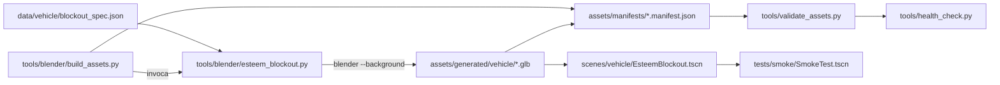

# Fábrica de assets 3D (Blender headless)

**Estado:** implementada en Fase 1.3. Primer asset: bloqueo del Esteem con
LOD0/LOD1/LOD2 y ancla de rig. Sin mecánicas de conducción.  
**Regla maestra:** todo modelo procede de un script `bpy` reproducible y todo
asset generado tiene manifiesto con comando, hash, autor, licencia y fecha
(`AGENTS.md`, sección 11).

## 1. Principio

Ningún `.blend` se edita a mano. La fábrica construye geometría paramétrica a
partir de un contrato declarativo en JSON, la exporta a glTF (`.glb`) y deja un
manifiesto reproducible. Los originales de la biblioteca externa de referencias
nunca se copian, ni siquiera como texturas.



## 2. Comandos

```powershell
# Generar todos los assets (invoca Blender 4.5.16 en background)
.\tools\blender\build_assets.cmd

# Un solo objetivo
.\.venv\Scripts\python.exe tools\blender\build_assets.py --target vehicle.esteem.blockout

# Validar manifiestos, hashes, LODs y anclas (también corre dentro de health_check)
.\.venv\Scripts\python.exe tools\validate_assets.py
```

## 3. Contrato de datos del bloqueo

`data/vehicle/blockout_spec.json` describe el asset de forma declarativa:

- `dimensions`: cotas globales del vehículo. **Valores de diseño provisionales**
  (`source_status: provisional_design_value`): el manual de servicio disponible
  no incluye cotas de carrocería y las proporciones se estimaron desde las
  fotografías de la biblioteca externa. Deben verificarse antes de Fase 2/Fase 5.
- `masses`: cajas de greybox (bajos, capó, cabina, maletero, parachoces) en
  coordenadas de runtime: **X+ derecha, Y+ arriba, frente hacia −Z**.
- `wheels` y `materials`: ruedas derivadas de `track_m`, `wheelbase_m` y
  `wheel_radius_m`; materiales greybox originales del proyecto.
- `lods`: tres niveles con presupuesto máximo de triángulos decreciente.
- `rig_anchor`: anclas del futuro rig (manos IK, controles, ruedas, cámaras,
  puertas) con posiciones nombradas `anchor_*`.

Invariantes que `tools/validate_assets.py` comprueba sobre el spec:

- `largo = batalla + voladizo delantero + voladizo trasero` (tolerancia 2 cm).
- Las masas caben dentro del ancho/alto/largo declarados.
- IDs de ancla únicos, con prefijo `anchor_` y dentro de rangos razonables.
- `anchor_root` existe como raíz del rig.
- Los presupuestos de LOD son estrictamente decrecientes.

## 4. Salidas generadas

| Archivo | Tipo | Contenido |
|---|---|---|
| `assets/generated/vehicle/esteem_blockout_lod0.glb` | mesh_lod 0 | Bloqueo completo, 1.192 triángulos (máx. 8.000) |
| `assets/generated/vehicle/esteem_blockout_lod1.glb` | mesh_lod 1 | 440 triángulos (máx. 4.000) |
| `assets/generated/vehicle/esteem_blockout_lod2.glb` | mesh_lod 2 | 184 triángulos (máx. 1.500) |
| `assets/generated/vehicle/esteem_rig_anchor.glb` | rig_anchor | Armazón `EsteemRigAnchor`, `Skeleton3D` con 17 huesos `anchor_*` |

La escena `scenes/vehicle/EsteemBlockout.tscn` instancia los tres LODs (solo
LOD0 visible) y el ancla de rig. El cambio de LOD por distancia es alcance de
Fase 3.5/Fase 10; aquí solo se garantiza la existencia y el presupuesto.

Política de LOD (`AGENTS.md`, sección 9):

- Ningún modelo entra al juego sin LOD0/LOD1/LOD2.
- Los triángulos de cada nivel deben decrecer estrictamente.
- El presupuesto visible en Android es de 120.000 triángulos: el bloqueo del
  vehículo (1.192 en LOD0) queda muy por debajo; los espejos y el resto del
  mundo se medirán en su fase.

## 5. Manifiesto reproducible

`assets/manifests/esteem_blockout.manifest.json` registra:

- `generator.command`: comando exacto de Blender usado.
- `generator.script_sha256` y `generator.spec_sha256`: hashes de las entradas.
- `author`, `license`, `created_utc`: autor, licencia (CC BY-NC-SA 4.0 del arte
  3D propio, según `ASSET_LICENSE.md`) y fecha UTC.
- `outputs[]`: ruta, tipo, triángulos, vertices, objetos y `sha256` de cada glb.

`tools/validate_assets.py` falla si:

1. Falta cualquier campo obligatorio del manifiesto.
2. El script o el spec cambiaron desde la compilación (manifiesto obsoleto →
   regenerar con `tools\blender\build_assets.cmd`).
3. Un output falta o su `sha256` no coincide.
4. Faltan LOD0/LOD1/LOD2, no decrecen o superan su presupuesto.
5. El ancla de rig no contiene `anchor_root` o no coincide con el spec.

## 6. Coordenadas

El spec vive en coordenadas de runtime de Godot (Y arriba, frente −Z, X+
derecha). El script `bpy` convierte a coordenadas Blender (Z arriba, frente +Y)
y exporta con la conversión +Y-up estándar de glTF, de modo que el `.glb`
importado en Godot mantiene el frente hacia −Z. La fábrica verifica esta
convención con las posiciones del ancla de rig.

## 7. Licencias y referencias

- Todo el contenido es procedural y propio: sin texturas, mallas ni datos
  copiados de `C:\Dev\fotos de ejemplo`.
- Las fotografías se usaron solo para estimar proporciones; el registro está en
  `docs/reference/REFERENCE_USAGE_LOG.md`.
- No se reproducen marcas ni emblemas (Chevrolet, PDV y otros).
- Las cotas provisionales no se publican como especificación oficial.

## 8. Ampliación futura

Los siguientes assets (exterior final F3.1, interior F3.2, biomas F4.3, fauno
F5.3, entidades F6.2, pasajeros F7.3) añadirán objetivos a `TARGETS` en
`tools/blender/build_assets.py`, cada uno con su spec, su script `bpy` y su
manifiesto. El validador y el health check ya cubren cualquier manifiesto nuevo
que siga el contrato.
