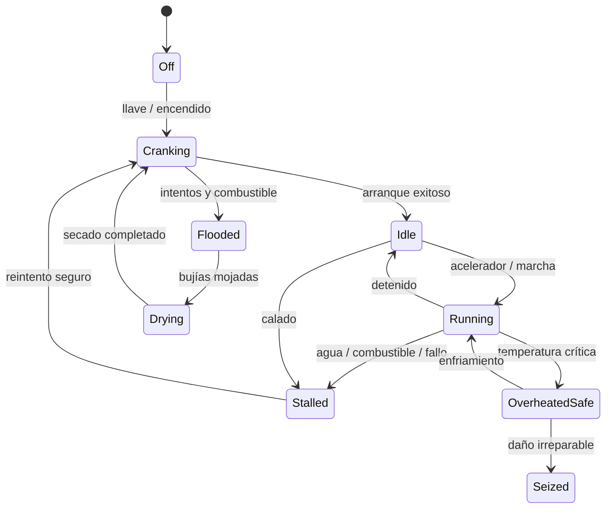
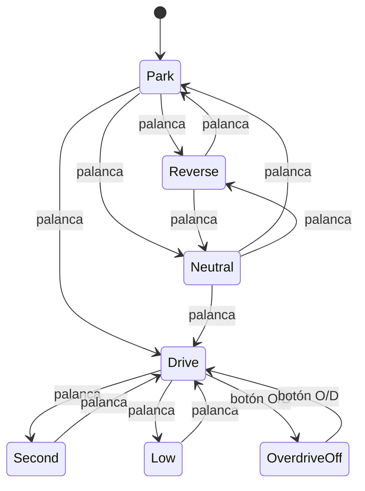
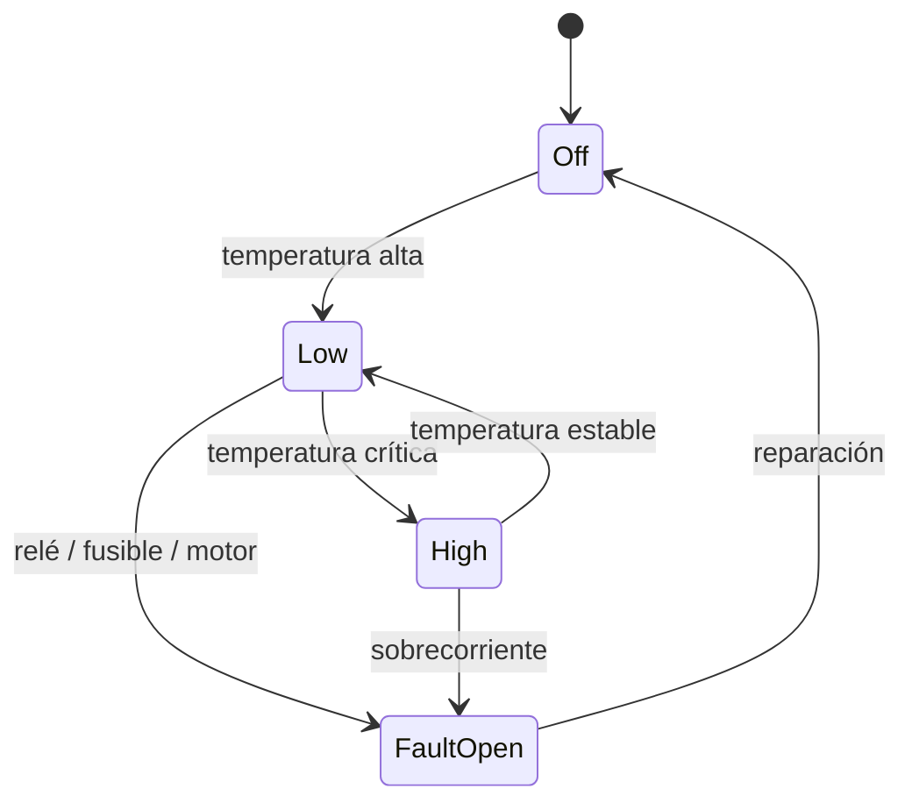
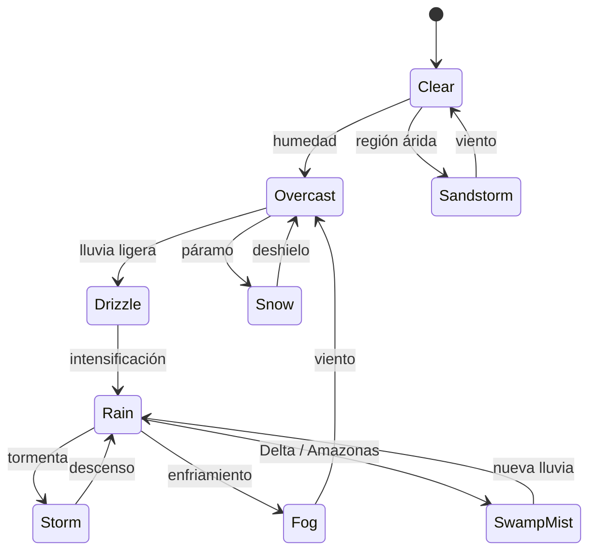
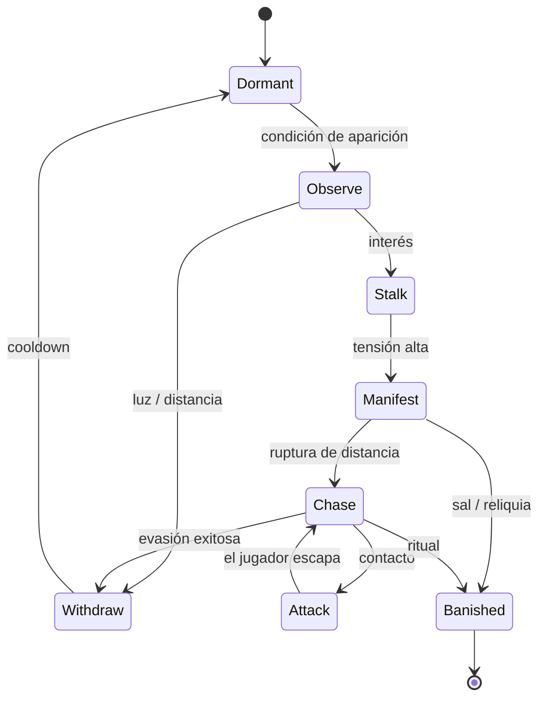
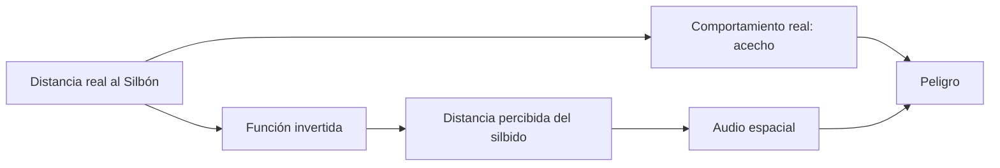
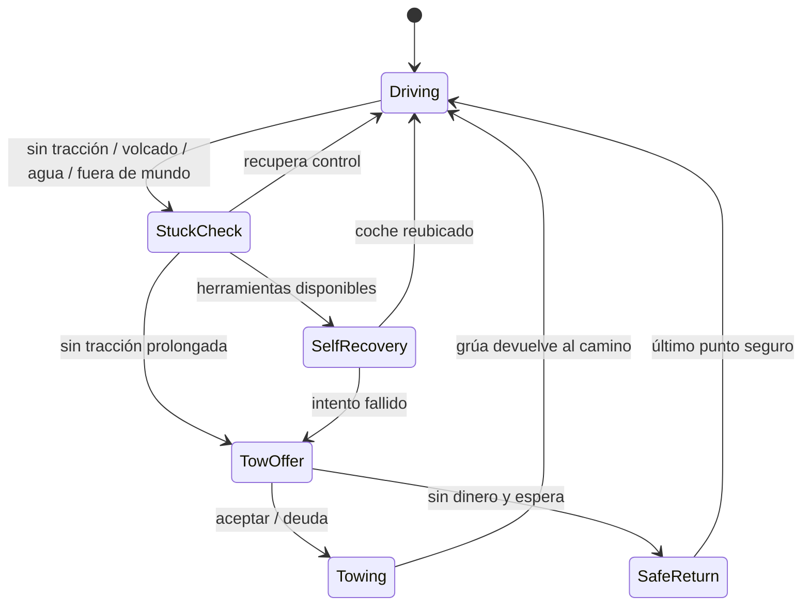
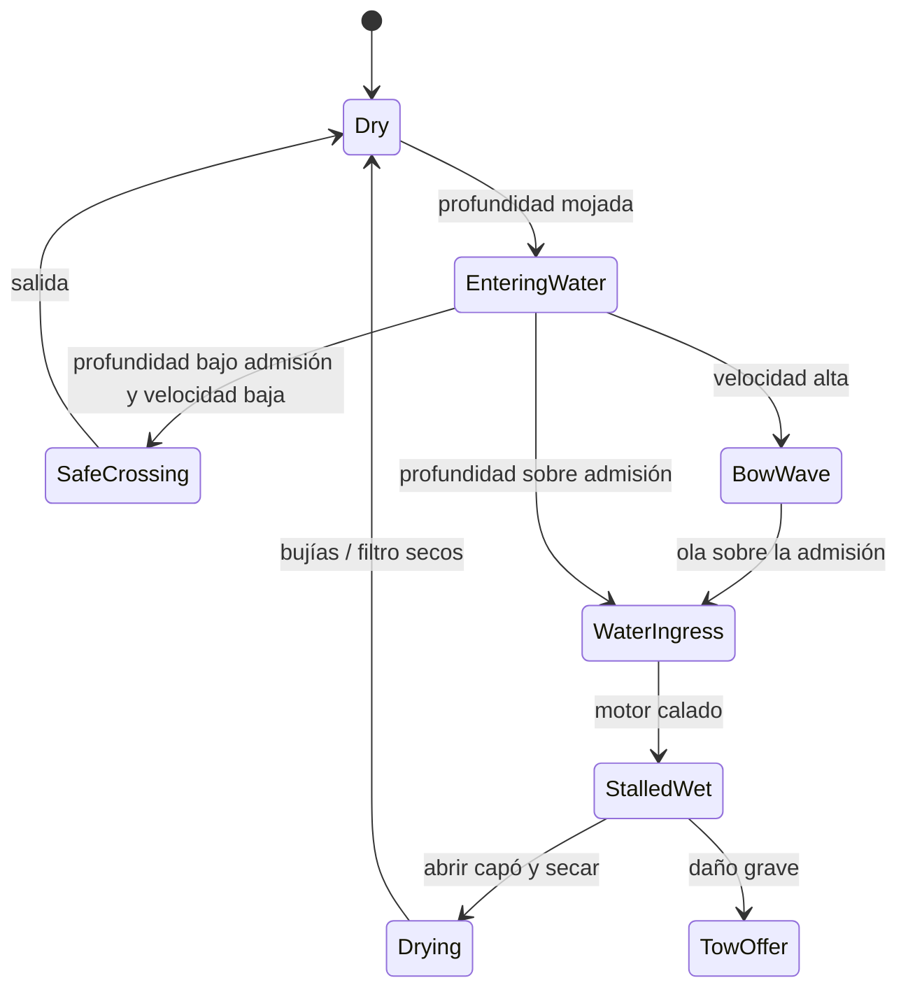

# Máquinas de estados

**Estado:** blueprint de Fase 1.1. Las transiciones se implementan en fases posteriores.  
Los umbrales numéricos pertenecen a los contratos JSON y deben probarse; no se
codifican en la UI.

## 1. Vehículo

### Motor



Regla anti-atasco: un motor `Seized` nunca deja una partida irrecuperable. El
sistema de rescate puede remolcar o recuperar el último punto seguro.

### Transmisión



`P-R-N-D-2-L` no se cambia por UI flotante; se manipula la palanca física con la
mano IK y el modo contextual. Cambios inválidos se rechazan con feedback físico.

### Electroventilador



Los síntomas distinguen fusible, relé y motor. No se puede diagnosticar solo con
“temperatura alta”: el jugador debe observar el comportamiento y revisar el panel.

## 2. Clima



Las transiciones tienen duración, intensidad y probabilidad. El trueno se
retrasa según la distancia del rayo; la humedad alimenta gotas, limpiaparabrisas
y charcos.

## 3. Entidad del folclore



`data/schemas/folklore_entities.json` decide las condiciones, los radios y los
objetos válidos. La IA no inventa excepciones fuera del contrato.

## 4. Silbón: distancia invertida

La dirección se conserva. La **distancia percibida** se invierte:

```text
real_near_m = 15
real_far_m  = 80
```



Casos de prueba obligatorios:

1. Entidad a 12 m → el silbido se percibe lejano; peligro real alto.
2. Entidad a 85 m → el silbido se percibe cercano; peligro real bajo.
3. La dirección del altavoz corresponde a la posición real.
4. Apagar motor, luces y radio reduce el riesgo.
5. El indicador visual direccional sigue funcionando para jugadores sordos.

## 5. Rescate y anti-atasco



La oferta de rescate aparece después de un tiempo prudencial, no castiga al
jugador por explorar y no puede activarse desde la UI para saltarse la física sin
pasar por la validación de recuperación.

## 6. Vadeo



- La altura de la admisión es `specs.water.air_intake_height_m`.
- La velocidad y la profundidad se calculan con la física real del vehículo.
- El secado requiere filtro/bujías, rags and flashlight.
- La recuperación por grúa sigue disponible.

## 7. Guardado y migración

Un guardado no es una máquina de estados de gameplay, pero sí tiene estados:

```text
Snapshot → Validate → Migrate → Backup → Temp Write → Verify → Rename → Notify
```

Cualquier fallo deja el archivo anterior intacto y un reporte legible.
