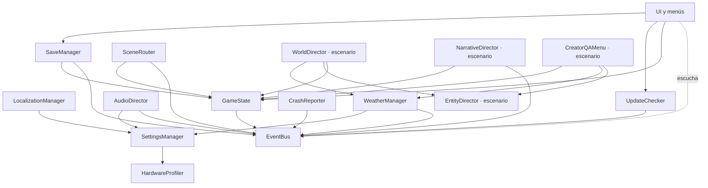

# Arquitectura de sistemas

**Estado:** contrato de Fase 1.1. Los servicios se implementan en Fase 1.2.  
**Fuente de dependencias:** `data/schemas/autoload_dependencies.json`.

## 1. Principio

El proyecto es un monolito modular, no una red de singletons. La UI solicita
acciones a servicios concretos y escucha eventos. Los servicios no conocen los
nodos de UI. `EventBus` es el único mediador de notificaciones.



Las flechas significan **dependencia directa de llamada**. La UI escucha el bus
con una suscripción; no es una dependencia de llamada desde el bus. El grafo de
autoloads se valida acíclico en `tools/validate_schemas.py`.

## 2. Responsabilidades

| Componente | Responsabilidad | No debe hacer |
|---|---|---|
| `EventBus` | Señales tipadas, desacoplamiento | Conocer reglas de juego |
| `HardwareProfiler` | SoC, GPU, memoria, perfil recomendado | Cambiar ajustes sin pasar por Settings |
| `SettingsManager` | Persistir opciones, accesibilidad y calidad | Guardar partidas |
| `LocalizationManager` | Locale, fallback, fuentes, plurales | Escribir textos en lógica |
| `GameState` | Estado de campaña y snapshot serializable | Escribir archivos de guardado |
| `SaveManager` | Escritura atómica, migraciones, backups | Mutar el mundo directamente |
| `AudioDirector` | Buses, prioridad, reverb, indicadores accesibles | Ejecutar reglas de entidades |
| `WeatherManager` | Clima, humedad, rayos, niebla | Decidir misiones |
| `UpdateChecker` | Comparar releases de GitHub | Instalar APK en build Play |
| `CrashReporter` | Logs y contexto de fallos | Subir datos a internet |
| `SceneRouter` | Cambios de escena y estados de carga | Guardar estado de juego |
| `WorldDirector` | Streaming, rutas, sectores y POIs | Ser autoload global |
| `EntityDirector` | Fauna, tráfico y folclore | Ser autoload global |
| `NarrativeDirector` | Diálogos, confianza y finales | Escribir en disco |

## 3. Orden de inicialización

`autoload_dependencies.json` es la fuente de verdad. El orden se obtiene por
orden topológico y se verifica que no exista un ciclo. El orden esperado es:

1. `EventBus`
2. `HardwareProfiler`
3. `SettingsManager`
4. `LocalizationManager`
5. `GameState`
6. `SaveManager`
7. `CrashReporter`
8. `AudioDirector`
9. `WeatherManager`
10. `UpdateChecker`
11. `SceneRouter`

`WorldDirector`, `EntityDirector`, `NarrativeDirector` y `CreatorQAMenu` se
instancian dentro de sus escenas y no sobreviven al cambio de mundo.

## 4. Flujos principales

### Arranque

1. `EventBus` y servicios base.
2. `CrashReporter` instala el logger y detecta un cierre previo anormal.
3. `HardwareProfiler` detecta el equipo y sugiere un perfil.
4. `SettingsManager` aplica ajustes y accesibilidad.
5. `LocalizationManager` carga el locale y la fuente.
6. `UpdateChecker` consulta la versión sin bloquear.
7. `SceneRouter` abre boot o menú.

### Guardado

1. La UI o el autoguardado piden un snapshot.
2. `GameState` construye un objeto serializable.
3. `SaveManager` valida `save_version`, checksum y esquema.
4. Escribe temporalmente, verifica y renombra de forma atómica.
5. Publica `save_completed` o `save_failed`.
6. La UI solo recibe el resultado.

### Clima

1. `WorldDirector` informa la región y el bioma.
2. `WeatherManager` selecciona un preset y publica `weather_changed`.
3. `AudioDirector` adapta ambientes y reverb.
4. Shaders y VFX leen un estado global de humedad y viento.
5. El estado meteorológico se incluye en snapshots y reportes de error.

### Entidades

1. `EntityDirector` selecciona una entidad según bioma, clima, hora y banderas.
2. La entidad publica estados; `AudioDirector` y VFX reaccionan.
3. El silbido del Silbón se procesa con una ley invertida de distancia.
4. La desaparición o destierro actualiza el estado narrativo de forma explícita.

### Actualización

1. `UpdateChecker` consulta GitHub si la build lo permite.
2. Si hay versión nueva, publica un evento y la UI muestra las notas.
3. En la build de GitHub, abre la descarga.
4. En la build de Play, abre la ficha de Play Store.
5. Nunca se autoinstala en la variante de tienda.

## 5. Reglas de dependencia

- Prohibido llamar a la UI desde un servicio.
- Prohibido que `GameState` llame directamente a `SaveManager`.
- Prohibido que `AudioDirector` dependa de `WeatherManager`.
- Prohibida cualquier dependencia circular de autoloads.
- Las referencias entre datos usan IDs estables, no rutas de nodos.
- La red solo se usa para OTA; el juego no depende de internet.
- Toda comunicación asíncrona reporta éxito y error por el bus.
- Los accidentes nativos se documentan con un marcador de sesión; no se finge capturarlos.

## 6. Datos y runtime

Los JSON de `data/schemas/` son la fuente canónica. Un pipeline validará y
generará recursos tipados para el runtime. El juego no debe interpretar datos sin
validar ni contener valores de balance dispersos en GDScript.

## 7. Verificación

```powershell
.\.venv\Scripts\python.exe tools\validate_schemas.py
.\.venv\Scripts\python.exe tools\health_check.py --start
```

Un ciclo, un autoload faltante o una referencia inválida es un error bloqueante.
