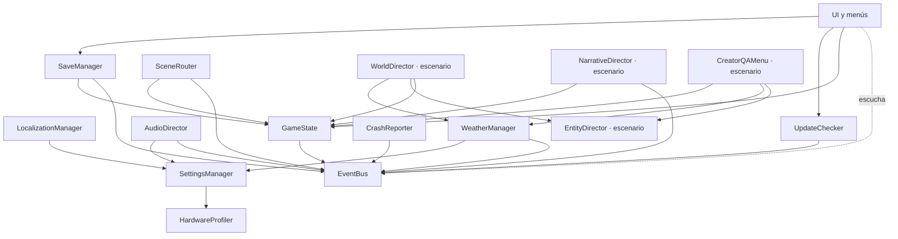
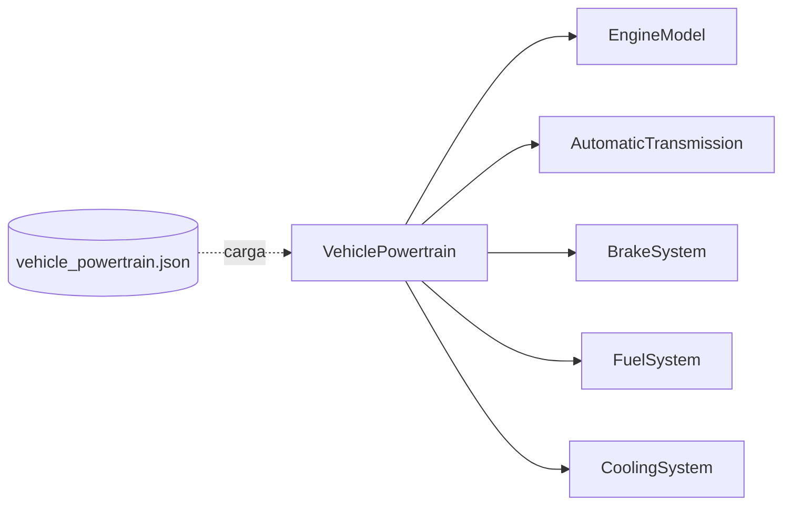
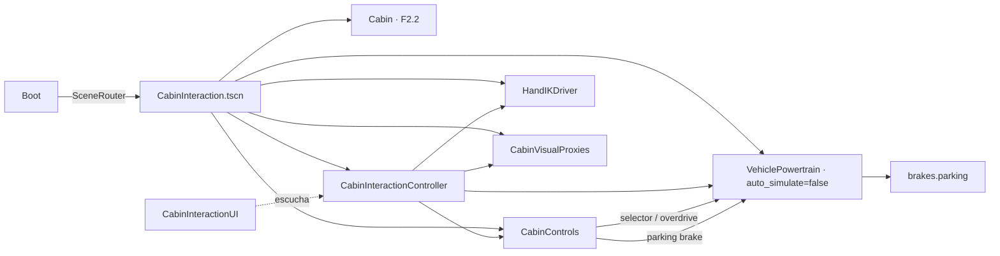
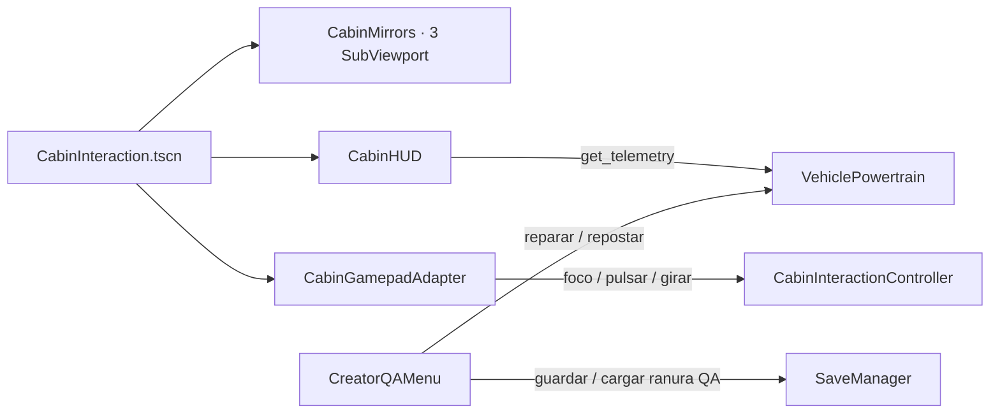

# Arquitectura de sistemas

**Estado:** contrato de Fase 1.1; autoloads base implementados en Fase 1.2.  
**Fuente de dependencias:** `data/schemas/autoload_dependencies.json`.  
**Catálogo de señales:** `docs/architecture/EVENT_BUS.md`.

## 1. Principio

El proyecto es un monolito modular, no una red de singletons. La UI solicita
acciones a servicios concretos y escucha eventos. Los servicios no conocen los
nodos de UI. `EventBus` es el único mediador de notificaciones.



Las flechas significan **dependencia directa de llamada**. La UI escucha el bus
con una suscripción; no es una dependencia de llamada desde el bus. El grafo de
autoloads se valida acíclico en `tools/validate_schemas.py`.

## 2. Responsabilidades

| Componente | Responsabilidad | No debe hacer |
|---|---|---|
| `EventBus` | Señales tipadas, desacoplamiento | Conocer reglas de juego |
| `HardwareProfiler` | SoC, GPU, memoria, perfil recomendado | Cambiar ajustes sin pasar por Settings |
| `SettingsManager` | Persistir opciones, accesibilidad y calidad | Guardar partidas |
| `LocalizationManager` | Locale, fallback, fuentes, plurales | Escribir textos en lógica |
| `GameState` | Estado de campaña y snapshot serializable | Escribir archivos de guardado |
| `SaveManager` | Escritura atómica, migraciones, backups | Mutar el mundo directamente |
| `AudioDirector` | Buses, prioridad, reverb, indicadores accesibles | Ejecutar reglas de entidades |
| `WeatherManager` | Clima, humedad, rayos, niebla | Decidir misiones |
| `UpdateChecker` | Comparar releases de GitHub | Instalar APK en build Play |
| `CrashReporter` | Logs y contexto de fallos | Subir datos a internet |
| `SceneRouter` | Cambios de escena y estados de carga | Guardar estado de juego |
| `WorldDirector` | Streaming, rutas, sectores y POIs | Ser autoload global |
| `EntityDirector` | Fauna, tráfico y folclore | Ser autoload global |
| `NarrativeDirector` | Diálogos, confianza y finales | Escribir en disco |

## 3. Orden de inicialización

`autoload_dependencies.json` es la fuente de verdad. El orden se obtiene por
orden topológico y se verifica que no exista un ciclo. El orden esperado es:

1. `EventBus`
2. `HardwareProfiler`
3. `SettingsManager`
4. `LocalizationManager`
5. `GameState`
6. `SaveManager`
7. `AudioDirector`
8. `WeatherManager`
9. `UpdateChecker`
10. `CrashReporter`
11. `SceneRouter`

`WorldDirector`, `EntityDirector`, `NarrativeDirector` y `CreatorQAMenu` se
instancian dentro de sus escenas y no sobreviven al cambio de mundo.

## 4. Flujos principales

### Arranque

1. `EventBus` y servicios base.
2. `CrashReporter` instala el logger y detecta un cierre previo anormal.
3. `HardwareProfiler` detecta el equipo y sugiere un perfil.
4. `SettingsManager` aplica ajustes y accesibilidad.
5. `LocalizationManager` carga el locale y la fuente.
6. `UpdateChecker` consulta la versión sin bloquear.
7. `SceneRouter` abre boot o menú.

### Guardado

1. La UI o el autoguardado piden un snapshot.
2. `GameState` construye un objeto serializable.
3. `SaveManager` valida `save_version`, checksum y esquema.
4. Escribe temporalmente, verifica y renombra de forma atómica.
5. Publica `save_completed` o `save_failed`.
6. La UI solo recibe el resultado.

### Clima

1. `WorldDirector` informa la región y el bioma.
2. `WeatherManager` selecciona un preset y publica `weather_changed`.
3. `AudioDirector` adapta ambientes y reverb.
4. Shaders y VFX leen un estado global de humedad y viento.
5. El estado meteorológico se incluye en snapshots y reportes de error.

### Entidades

1. `EntityDirector` selecciona una entidad según bioma, clima, hora y banderas.
2. La entidad publica estados; `AudioDirector` y VFX reaccionan.
3. El silbido del Silbón se procesa con una ley invertida de distancia.
4. La desaparición o destierro actualiza el estado narrativo de forma explícita.

### Actualización

1. `UpdateChecker` consulta GitHub si la build lo permite.
2. Si hay versión nueva, publica un evento y la UI muestra las notas.
3. En la build de GitHub, abre la descarga.
4. En la build de Play, abre la ficha de Play Store.
5. Nunca se autoinstala en la variante de tienda.

## 5. Reglas de dependencia

- Prohibido llamar a la UI desde un servicio.
- Prohibido que `GameState` llame directamente a `SaveManager`.
- Prohibido que `AudioDirector` dependa de `WeatherManager`.
- Prohibida cualquier dependencia circular de autoloads.
- Las referencias entre datos usan IDs estables, no rutas de nodos.
- La red solo se usa para OTA; el juego no depende de internet.
- Toda comunicación asíncrona reporta éxito y error por el bus.
- Los accidentes nativos se documentan con un marcador de sesión; no se finge capturarlos.

## 6. Datos y runtime

Los JSON de `data/schemas/` son la fuente canónica. Un pipeline validará y
generará recursos tipados para el runtime. El juego no debe interpretar datos sin
validar ni contener valores de balance dispersos en GDScript.

## 7. Verificación

```powershell
.\.venv\Scripts\python.exe tools\validate_schemas.py
.\.venv\Scripts\python.exe tools\health_check.py --start
```

Un ciclo, un autoload faltante o una referencia inválida es un error bloqueante.

## 8. Implementación de la Fase 1.2

Los once autoloads están declarados en `project.godot` exactamente en el orden
topológico del contrato:

1. `EventBus` — `src/core/event_bus.gd`
2. `HardwareProfiler` — `src/core/hardware_profiler.gd`
3. `SettingsManager` — `src/core/settings_manager.gd`
4. `LocalizationManager` — `src/core/localization_manager.gd`
5. `GameState` — `src/core/game_state.gd`
6. `SaveManager` — `src/core/save_manager.gd`
7. `AudioDirector` — `src/core/audio_director.gd`
8. `WeatherManager` — `src/core/weather_manager.gd`
9. `UpdateChecker` — `src/core/update_checker.gd`
10. `CrashReporter` — `src/core/crash_reporter.gd`
11. `SceneRouter` — `src/core/scene_router.gd`

Reglas aplicadas:

- Ningún autoload conoce nodos de UI.
- `GameState` publica `save_requested`; `SaveManager` lee el snapshot y aplica la
  carga sobre el estado, no sobre el mundo.
- `EventBus` es el único mediador de notificaciones.
- `CrashReporter` recibe contexto por `diagnostics_context_updated`; no llama a
  otros servicios.
- `LocalizationManager` carga `localization/strings.csv` en runtime para no
  depender de artefactos de importación. El preset de export de la Fase 1.4 debe
  incluir el CSV con `include_filter` (o registrar los `.translation` generados).
- `SceneRouter` usa `ResourceLoader.load_threaded_request()` y un solo cambio de
  escena a la vez.
- `CreatorQAMenu` es un servicio de escena instanciado en Boot y, en el futuro, en
  la pausa. No es autoload.
- El smoke test `tests/smoke/SmokeTest.tscn` valida los once autoloads, EventBus,
  ajustes, localización, guardado, clima, audio, actualizaciones, diagnóstico,
  caja negra, panel QA y SceneRouter sin mecánicas de conducción.

## 9. Rebanada vertical y arranque (Fase 1.4)

- `scenes/boot/Boot.tscn` sigue siendo la escena principal: verifica servicios y
  ofrece un botón localizado para abrir la rebanada vertical.
- `scenes/vertical_slice/VerticalSlice.tscn` es una escena **estática** de
  presentación: terreno, carretera gris, marcas de carril generadas al arrancar,
  cámara y el bloqueo del Esteem. No contiene `VehicleBody3D`, `RigidBody3D`,
  `CharacterBody3D`, tráfico, clima simulado ni entidades.
- La escena solo instancia `EsteemBlockout.tscn`; no importa imágenes de la
  biblioteca externa ni introduce texturas nuevas.
- El botón de retorno y el botón de acceso cumplen 48 px de alto y usan claves de
  localización (`UI_VIEW_SLICE`, `SLICE_TITLE`, `SLICE_SUBTITLE`, `UI_BACK`).
- `LocalizationManager` intenta primero los objetos de traducción registrados y,
  si no están, carga los `.translation` importados por locale. El CSV sigue siendo
  la fuente de verdad en el código fuente.
- El export de Windows y la APK Android se generan con `tools/dev/export.ps1`;
  la prueba de dispositivo está en `tools/test_android_adb.ps1` y el detalle en
  `docs/architecture/BUILD_AND_RELEASE.md`.

## 10. Tren motriz (Fase 2.1)

El tren motriz es un módulo de escena, no un autoload. `VehiclePowertrain`
(`src/vehicle/vehicle_powertrain.gd`) orquesta cinco modelos de simulación y
expone señales locales para que F2.2/F2.4 los conecten al coche y al HUD.



Reglas:

- `VehiclePowertrain` no conoce la UI, la cabina, las manos IK ni `EventBus`.
  Emite señales propias (`engine_state_changed`, `gear_changed`,
  `selector_changed`, `overdrive_changed`, `warning_changed`, `stalled`,
  `overheated`, `seized`). Un controlador de vehículo podrá reenviarlas al bus en
  F2.4 si hace falta.
- La simulación es longitudinal y determinista. `simulate(delta)` permite
  avanzar el modelo sin `_physics_process`, lo que hace las pruebas headless
  reproducibles. `auto_simulate` se desactiva en los tests.
- El motor recibe una velocidad objetivo de giro y una carga; no calcula el
  movimiento del chasis. La caja convierte par de motor en par de rueda. Los
  frenos y la resistencia del vehículo se integran en el orquestador.
- La temperatura ambiente se inyecta con `set_ambient_temperature()`. La conexión
  con `WeatherManager` se hará en F4.4, no desde el módulo de vehículo.
- El modelo no crea `VehicleBody3D` ni colisiones. La integración con la física
  real del chasis y las ruedas es alcance de F2.2–F2.4/F3.
- Los umbrales viven en `data/schemas/vehicle_powertrain.json`. No se codifican
  valores de balance en la UI ni en scripts de presentación.
- El motor agarrotado (`seized`) tiene una API de reparación para QA y pruebas.
  La recuperación anti-atasco completa (grúa, deuda, punto seguro) es F5.1; esta
  subfase no la simula.

## 11. Interacción de cabina (Fase 2.3)

La interacción contextual es un **servicio de escena**, no un autoload. Vive en
`scenes/vehicle/CabinInteraction.tscn`, que instancia la cabina de F2.2 y añade
un `VehiclePowertrain` sin simulación automática.



Responsabilidades:

| Componente | Responsabilidad | No debe hacer |
|---|---|---|
| `CabinInteractionController` | Foco, tacto, gestos, delegación y ciclo de vida | Simular conducción ni guardar |
| `CabinControls` | Puertas, seguros, vidrios, luces, radio, antena, guantera y palanca | Duplicar caja, motor o frenos |
| `HandIKDriver` | Poses 2/1/0 manos, cadena de dos huesos y transiciones | Mover el chasis ni crear física |
| `CabinVisualProxies` | Vidrio, antena, testigos, botones, manos y offsets funcionales | Ser arte final o copiar fotos |
| `CabinInteractionUI` | Retículo y prompt localizado | Contener lógica de juego o botones persistentes |
| `VehiclePowertrain` | Motor, caja, frenos y térmica (F2.1) | Conocer la cabina o la UI |

Reglas:

- La escena de interacción no crea `VehicleBody3D`, `RigidBody3D`,
  `CharacterBody3D` ni `VehicleWheel3D`; la conducción real es F2.4/F3.
- `CabinInteractionController` usa señales locales. F2.4 podrá reenviarlas al
  `EventBus` para HUD, espejos, audio y guardado; F2.3 no lo hace.
- `Boot` ofrece acceso directo a la cabina con `UI_VIEW_CABIN` y
  `SceneRouter.change_scene()`.
- La UI no captura eventos: el controlador recibe tacto/ratón y el prompt solo
  dibuja. No hay gamepad en F2.3.
- Las posiciones de bind siguen siendo las de F2.2. Los `visual_offsets` y los
  proxies mueven los mandos a la cara del conductor para que sean visibles y
  alcanzables; la geometría definitiva es F3.2.
- Solo se anima LOD0. El cambio de LOD es F3.5/F10; los espejos retrovisores
  llegaron en F2.4 (sección 12).

## 12. Espejos, HUD, gamepad y guardado (Fase 2.4)

F2.4 añade sobre la cabina de F2.2/F2.3 cuatro piezas, todas sin física de
conducción y sin duplicar el tren motriz:



| Componente | Responsabilidad | No debe hacer |
|---|---|---|
| `CabinMirrors` | Espejo interior y dos laterales con `SubViewport`, cámara propia y cadencia `update_hz` del contrato | Ser arte final ni exceder su presupuesto de triángulos |
| `CabinHUD` | Overlay mínimo: velocidad, marcha, combustible y avisos leídos de `get_telemetry()` | Escribir en el tren motriz, replicar el instrumental o crear botones |
| `CabinGamepadAdapter` | D-Pad enfoca los controles contextuales, A pulsa, B suelta, stick derecho rota la cámara | Manejar tacto/ratón (siguen en F2.3) o navegar menús |
| `CreatorQAMenu` (F2.4) | Reparaciones y repostaje por `VehiclePowertrain`; guardado/carga QA por `SaveManager` | Editar archivos o mutar nodos del mundo |
| `SaveManager` (F2.4) | Línea base `save_version: 1` / `game_version: 0.2.0`, checksum, backup y rechazo de versiones futuras | Migraciones encadenadas (F9.4) |

Reglas:

- Los tres viewports comparten el `World3D` de la escena; sus pasos de render
  cuentan en el presupuesto móvil de triángulos (`mirrors.budget` de
  `cabin_interaction.json` v2). `set_viewports_enabled(false)` los apaga para el
  perfil de bajo consumo.
- El HUD refresca a `hud.refresh_hz` y traduce los ocho códigos de aviso del
  contrato de simulación (`fuel_low` … `engine_seized`) con claves `HUD_WARN_*`.
- El gamepad reutiliza el foco, el gesto y los límites de cámara de F2.3
  (`focus_next_control`, `rotate_camera_look`). Los menús navegan con las
  acciones estándar `ui_*`, que en `project.godot` incluyen D-Pad, stick y A/B.
- El guardado F2.4 es la línea base de migraciones desde `v0.2.0`, verificada
  con `tests/fixtures/save_v0_2_0.json` y `tools/make_save_fixture.py`. Las
  migraciones encadenadas completas son F9.4.
- `GameState` sigue sin llamar a `SaveManager`; el panel QA usa las APIs
  directas de `SaveManager` permitidas al UI en el grafo de dependencias.
